

  <picture>
    <source media="(prefers-color-scheme: dark)" srcset="assets/logo-dark.svg">
    
  </picture>

  
  
  
  
  
  

  <b><a href="#get-access">Get access</a></b> · <a href="#watch-the-demo">Demo video</a> · <a href="#gallery">Gallery</a> · <a href="#what-you-can-do">Features</a> · <a href="#works-with-your-ai-assistant">Supported clients</a> · <a href="#faq">FAQ</a>

# Chartiva: turn any AI assistant into a data-visualization analyst
**Chartiva** is a Model Context Protocol (MCP) server and agent skill that lets AI assistants (Claude, ChatGPT, GitHub Copilot in VS Code, OpenCode/OpenChamber, Cursor, Gemini CLI and more) turn your data into **interactive charts, dashboards and analyses**.

Give your assistant a spreadsheet, a CSV export, a JSON API response, a network topology or a map, and ask a question in plain language. It profiles the data, picks the right chart, draws it with [D3.js](https://d3js.org), checks the result, and hands you an **interactive HTML file** that opens in any browser, plus SVG, PNG, PDF, CSV and a reusable chart specification.

You never write chart code. You keep talking instead: *"make it horizontal"*, *"highlight the top 5"*, *"use a dark theme"*, *"compare it with a violin plot"*, *"go back to the first version"*.

> This repository is the public showcase. The software is commercial: see [Get access](#get-access).

## Watch the demo

<a href="https://waqasdaar.github.io/chartiva/demo/">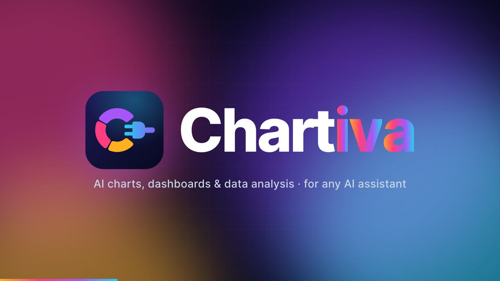</a>

<b><a href="https://waqasdaar.github.io/chartiva/demo/">▶ Watch the 82-second demo</a></b>: eight questions, one answer, and five roles (CFO, data scientist, CIO, manager, network admin) getting real charts from plain-language requests.

## Gallery

Every image below was produced by Chartiva from a single plain-language request.

| | |
| :---: | :---: |
| 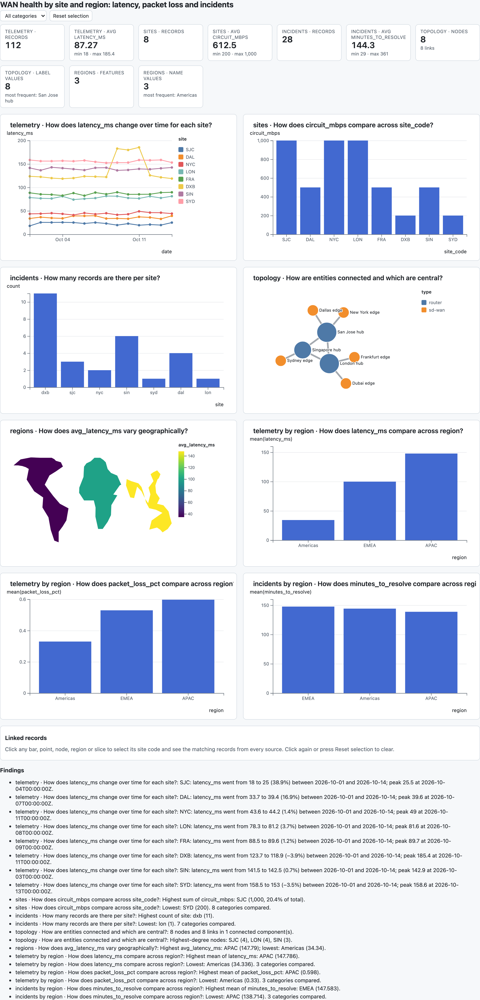 **Linked dashboard from five files**: Excel, CSV, JSON, YAML and GeoJSON, joined automatically. Click a site in one chart and it lights up in all of them. | 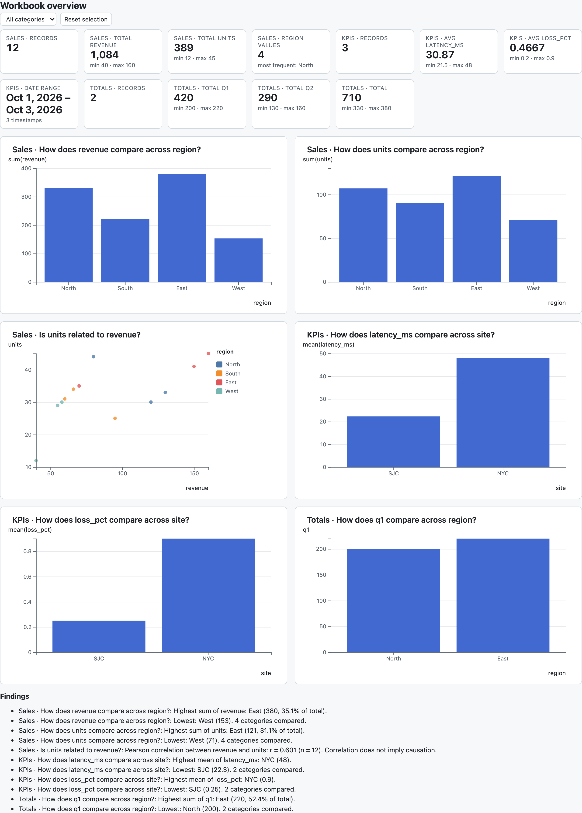 **Automatic dashboard from an Excel workbook**: charts chosen per sheet, with KPI tiles. |
| 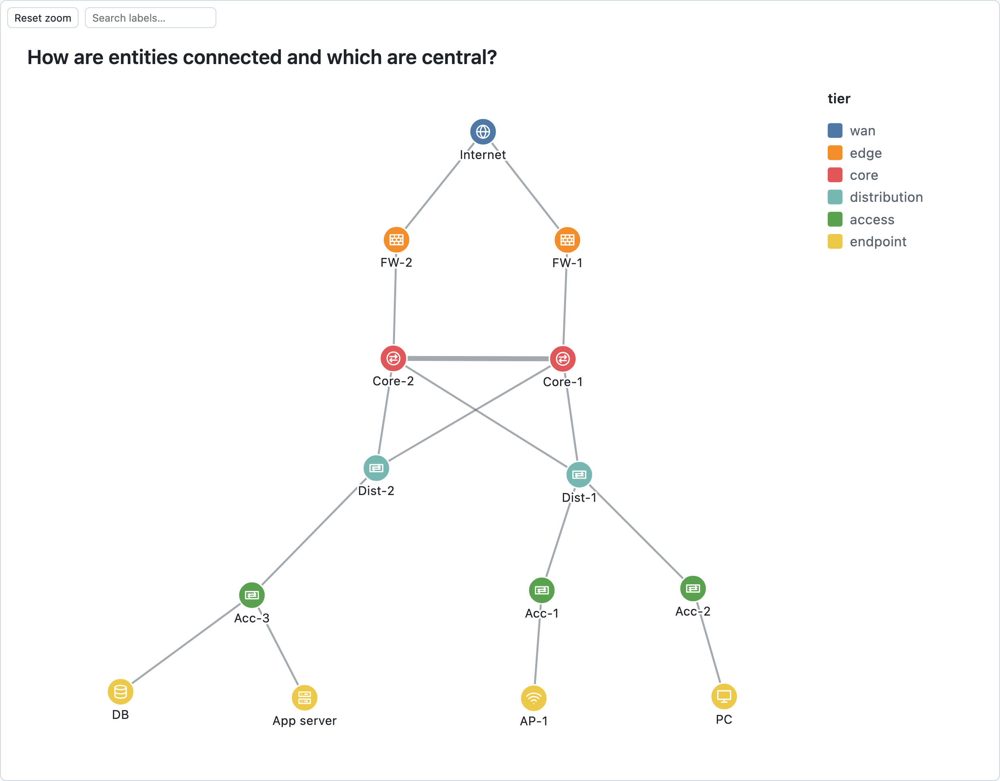 **Network topology with device icons** in a tiered layout (WAN, edge, core, distribution, access). | 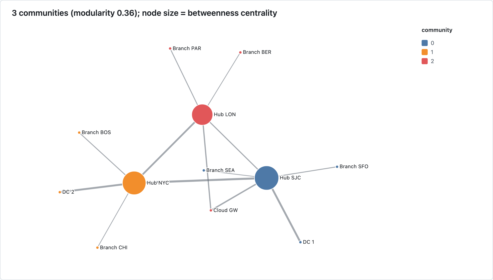 **Graph analytics**: Louvain communities, betweenness centrality and shortest paths, computed exactly. |
| 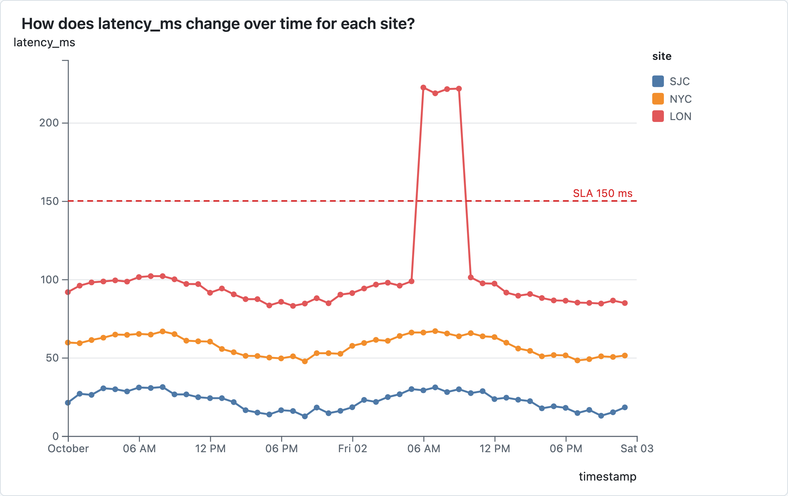 **Time series** with an SLA threshold: the latency spike stands out at a glance. | 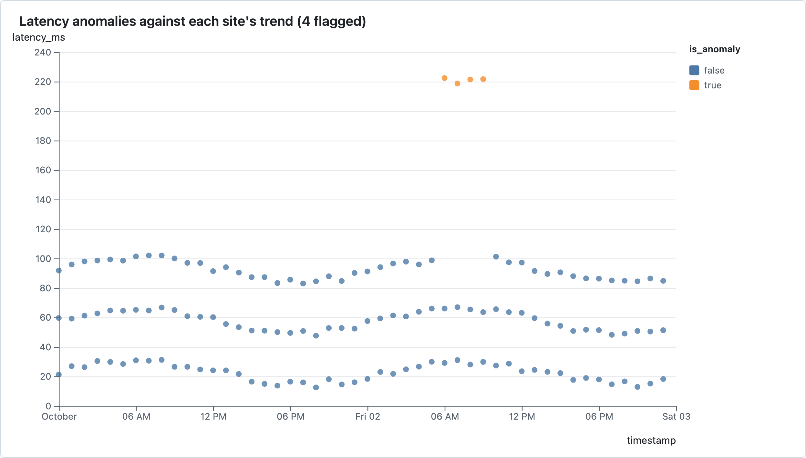 **Anomaly detection** against each site's own trend, so steady growth isn't flagged. |
| 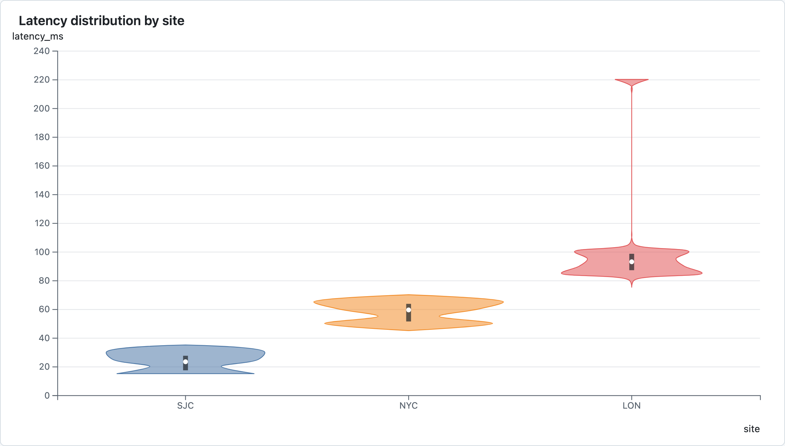 **Violin plot**: full distributions per group, not just quartiles. | 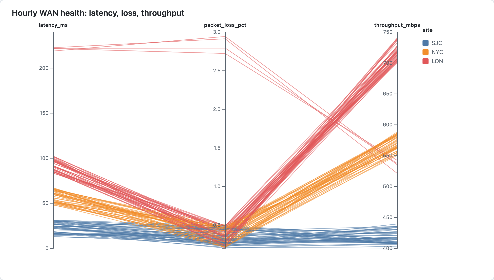 **Parallel coordinates**: drag on any axis in the HTML to filter records. |
| 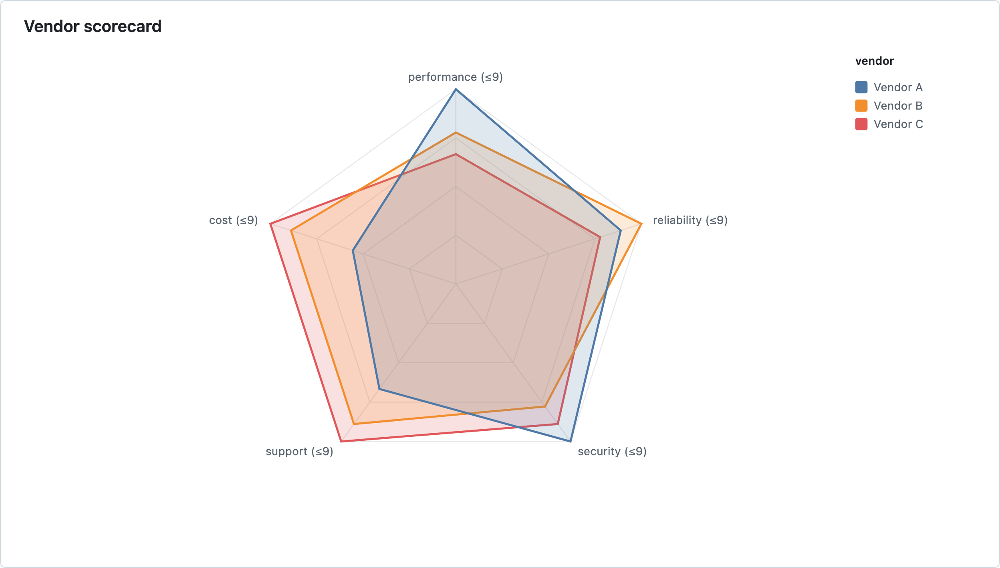 **Radar chart**: compare entities across several measures. | 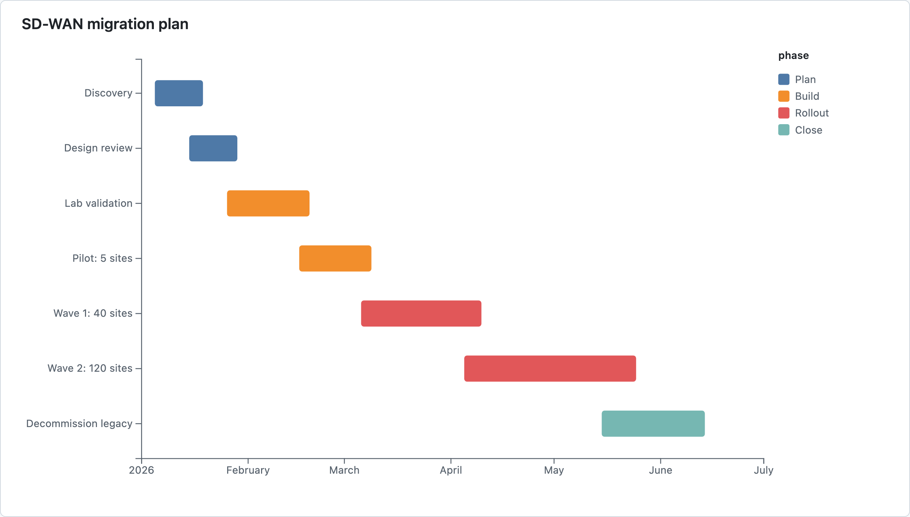 **Gantt chart** from start and end dates. |
| 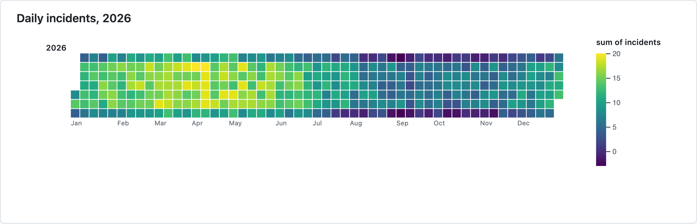 **Calendar heatmap**: weekday and seasonal patterns over a year. | 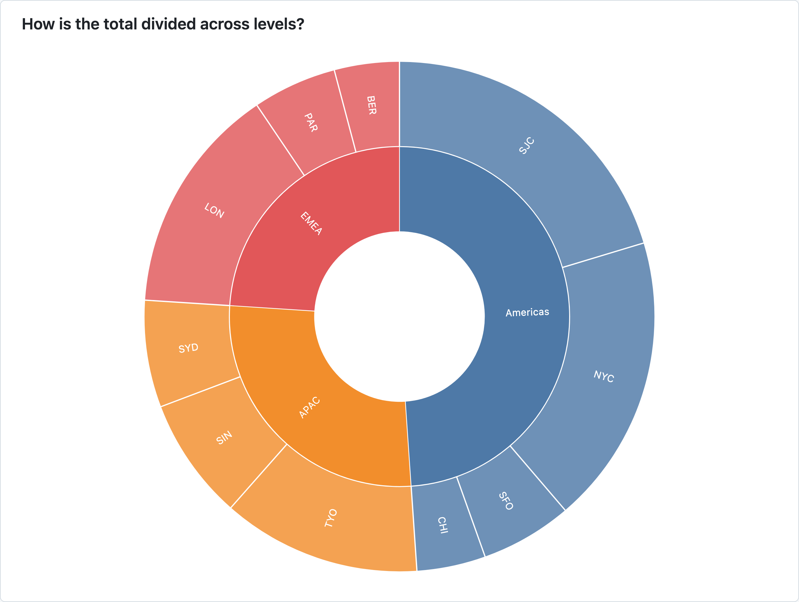 **Sunburst** for nested totals. |

The real output is interactive: tooltips, zoom and pan, time brushing, axis brushing, search, clickable legends, keyboard navigation and linked selection across charts. Large data is drawn on canvas (50,000-point scatterplots, 20,000-node networks).

## What you can do

- **Ask questions, get charts.** *"Revenue by region"*, *"latency over time per site"*, *"how is response time distributed?"*, *"is throughput related to CPU?"* The planner chooses from **37 chart types** and explains why.
- **Get a dashboard from raw files in one step.** Point it at Excel workbooks, CSVs and JSON; it picks the charts, adds KPI tiles and lays them out.
- **Connect related data sources.** It finds the fields that link datasets, asks you when a link is ambiguous, joins them, and makes the charts react to each other.
- **Understand networks.** Topologies with device icons, plus exact graph analytics: central nodes, communities, shortest paths.
- **Spot what's unusual.** Robust anomaly detection that respects trends and runs per group.
- **Refine and compare.** Edit any chart conversationally, keep its full version history (list, diff, restore), or see the same data as several chart types side by side, ranked.
- **Export and share.** One offline HTML file per chart (safe to email); SVG, PNG and PDF for slides and reports; CSV for the numbers.

**Chart types:** bar, grouped and stacked bar, waterfall, line, area, stacked area, cumulative, scatter, bubble, connected scatter, histogram, box plot, violin, density, heatmap, calendar, radar, parallel coordinates, Gantt, pie, donut, treemap, sunburst, icicle, circle packing, tree, dendrogram, force-directed network, radial network, chord, Sankey, choropleth and point maps (12 projections), Voronoi, Delaunay, contour density and custom shapes.

## Data you can bring

| Source | Formats |
| --- | --- |
| Tables | CSV, TSV and any delimiter (auto-detected), JSON, JSON Lines, YAML, or rows pasted into the chat |
| Spreadsheets | Excel `.xlsx` `.xlsm` `.xlsb` `.xls`, OpenDocument `.ods`; one sheet or every sheet |
| API responses | nested JSON, column-oriented and key/value objects |
| Networks | nodes and links, with weights and groups |
| Hierarchies | org charts, budgets, file sizes |
| Geography | GeoJSON, TopoJSON, latitude/longitude |

Everything stays on your computer. The server reads files only from the folders you allow, and never uploads data or calls the internet.

## Works with your AI assistant

| Client | Setup |
| --- | --- |
| Claude Desktop, Claude Code | automatic |
| ChatGPT desktop app, Codex CLI and IDE extension | automatic |
| ChatGPT on the web | via a secure HTTPS connection (guide included) |
| Visual Studio Code (GitHub Copilot), Copilot CLI | automatic |
| OpenCode, OpenChamber | automatic |
| Cursor, Windsurf, Gemini CLI | automatic |
| Any other MCP-compatible client | configuration templates included |

The download includes both parts: the **MCP server** (the tools) and the **agent skill** (instructions that teach the assistant when and how to use them, so it picks the right tool first time and reports results accurately).

## How it works

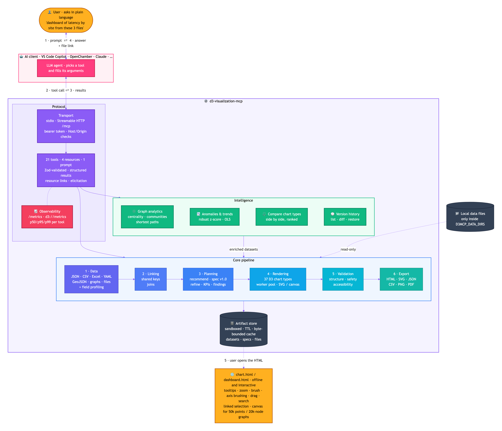

## What you get

- **One ZIP for macOS, Windows and Linux.** The only prerequisite is Node.js 20.19 or newer. Everything else is included; no internet access is needed to install.
- **One-click installer** that finds your AI apps, sets them up, installs the agent skill, backs up every file it touches, and runs a self-test.
- **Validation tool** that proves the server starts, connects and renders, and **uninstaller** that reverses every change.
- **Documentation:** installation, per-client setup, usage examples, troubleshooting and security.
- **Updates and support** as described in your license.

## Get access

Chartiva is commercial software; using it requires a license.

**To buy a license or ask a question, email [waqasdaar@gmail.com](mailto:waqasdaar@gmail.com?subject=Chartiva%20license).** Please mention:

- how many users need access,
- which AI assistants you use (Claude, ChatGPT, VS Code, …),
- your operating system.

You'll receive the download link, your license agreement and installation instructions. Setup takes about five minutes.

## FAQ

**Does my data leave my computer?**
No. The server runs locally, started by your AI app. It doesn't upload data, phone home or fetch URLs, and the HTML charts it produces can't make network requests either.

**Do I need to know D3 or programming?**
No. You ask in plain language; the assistant uses the tools. Developers can still use the full JSON specification and every tool parameter directly.

**Which operating systems are supported?**
macOS, Windows and Linux, with the same package.

**What does the AI assistant need?**
Any client that supports the Model Context Protocol. Agent-skill support makes it better at choosing tools, but isn't required.

**Can I see it working before buying?**
Ask at the email above.

## License

© 2026 Waqas Daar. All rights reserved. Chartiva is proprietary software; use requires a paid license agreement. The text, screenshots, logos and diagrams in this repository are provided for information only and may not be reused without permission. D3.js is © Mike Bostock and used under its ISC license; other names and trademarks belong to their owners.

